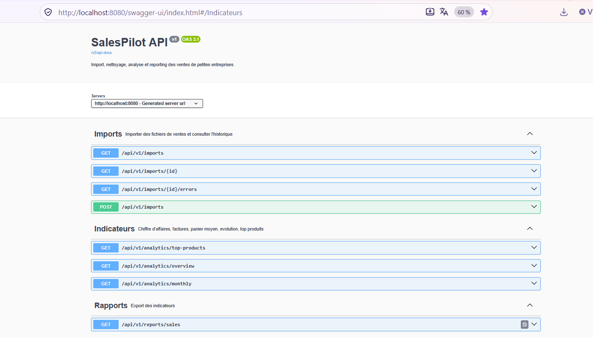

# SalesPilot

**Import, nettoyage, analyse et reporting des ventes pour les petites entreprises.**

SalesPilot transforme les exports de ventes bruts d'un commerce ou d'un distributeur (fichiers CSV ou Excel, par exemple issus de Sage Gestion commerciale) en données propres et en indicateurs fiables : chiffre d'affaires, nombre de factures, panier moyen, évolution mensuelle, produits les plus vendus. Il produit aussi un rapport Excel prêt à être envoyé.

Projet backend réalisé en Java / Spring Boot, conçu à partir de documents réels d'une entreprise de distribution au Cameroun (données de démonstration fictives).


---

## Fonctionnalités

**Import de fichiers**
- Formats acceptés : **CSV** et **Excel (.xlsx)**, reconnus par leur contenu (signature du fichier) et non par leur nom.
- **Reconnaissance automatique des colonnes** grâce à un dictionnaire de synonymes : `N° pièce`, `Référence article`, `Qtés vendues`, `order_ref`… sont reconnus quel que soit l'export.
- **Formats français** : séparateur `;`, nombres `1 248,90`, dates `06/01/26`, encodage UTF-8 ou Windows-1252.
- **Validation ligne par ligne** : une ligne invalide est mise de côté avec la raison du rejet, sans bloquer le reste du fichier.
- **Doublons** détectés dans le fichier et en base ; un fichier déjà importé est refusé (empreinte SHA-256).
- **Avoirs** (retours) gérés avec des quantités négatives.
- **Multi-devises** (XAF, EUR…) et **multi-agences**.

**Indicateurs**
- Synthèse par devise : chiffre d'affaires, factures, panier moyen, unités vendues.
- Évolution mensuelle, mois sans vente inclus.
- Classement des produits avec leur part du chiffre d'affaires.

**Rapport**
- Export Excel en trois onglets : synthèse, évolution mensuelle, top produits.

---

## Stack technique

| Domaine | Technologies |
|---|---|
| Langage | Java 17 |
| Framework | Spring Boot 4.1 (Spring MVC, Spring Data JPA, Validation) |
| Base de données | PostgreSQL 17, migrations **Flyway** |
| Fichiers | OpenCSV (lecture CSV), Apache POI (lecture et génération Excel) |
| Documentation | OpenAPI / Swagger UI (springdoc-openapi) |
| Tests | JUnit 5, AssertJ, **Testcontainers** (PostgreSQL réel) |
| Outillage | Maven, Docker Compose, Git |

---

## Démarrage rapide

**Prérequis** : Java 17 ou plus, Docker Desktop.

```bash
# 1. Lancer PostgreSQL
docker compose up -d

# 2. Lancer l'application (Windows : .\mvnw.cmd spring-boot:run)
./mvnw spring-boot:run
```

L'API est disponible sur `http://localhost:8080`, et sa documentation interactive sur **http://localhost:8080/swagger-ui.html**.

**Essai avec le fichier de démonstration** :

```bash
# Importer le fichier d'exemple (format Sage, données fictives)
curl -F "file=@samples/ventes_demo.csv" -F "currency=XAF" http://localhost:8080/api/v1/imports

# Indicateurs de janvier 2026
curl "http://localhost:8080/api/v1/analytics/overview?from=2026-01-01&to=2026-01-31"

# Rapport Excel
curl -o rapport.xlsx "http://localhost:8080/api/v1/reports/sales?from=2026-01-01&to=2026-01-31"
```

Le fichier d'exemple contient volontairement un doublon, un avoir et trois lignes invalides. Résultat attendu : 8 lignes lues, 4 importées, 3 rejetées, 1 doublon.

---

## API

| Méthode | Endpoint | Rôle |
|---|---|---|
| `POST` | `/api/v1/imports` | Importer un fichier (paramètres `file`, `currency`) |
| `GET` | `/api/v1/imports` | Historique des imports, paginé et triable |
| `GET` | `/api/v1/imports/{id}` | Détail d'un import |
| `GET` | `/api/v1/imports/{id}/errors` | Lignes rejetées et raison du rejet |
| `GET` | `/api/v1/analytics/overview` | Synthèse par devise (`from`, `to`) |
| `GET` | `/api/v1/analytics/monthly` | Évolution mensuelle (`from`, `to`) |
| `GET` | `/api/v1/analytics/top-products` | Produits les plus vendus (`from`, `to`, `limit`) |
| `GET` | `/api/v1/reports/sales` | Rapport Excel (`from`, `to`) |

Les erreurs suivent le format standard **ProblemDetail** (RFC 9457) : `400` requête invalide, `404` ressource introuvable, `409` fichier déjà importé, `413` fichier trop volumineux.

---

## Définition des indicateurs

Un indicateur n'a de valeur que si sa définition est claire. Tous les montants sont **hors taxes** et calculés **par devise** (on n'additionne jamais deux devises).

| Indicateur | Définition |
|---|---|
| Chiffre d'affaires | Somme des montants HT des lignes de vente, **avoirs déduits** |
| Factures | Nombre de pièces distinctes (agence + n° de pièce) ayant un montant positif ; les avoirs ne sont pas comptés |
| Panier moyen | Chiffre d'affaires ÷ nombre de factures |
| Unités vendues | Somme des quantités, retours déduits |
| Part du CA | Chiffre d'affaires du produit ÷ chiffre d'affaires total de la devise |

---

## Architecture

Monolithe Spring Boot organisé par fonctionnalité, en couches.

```
src/main/java/com/salespilot/salespilot/
├── imports/          Import des fichiers : contrôleur, service, entités ImportBatch et ImportError
│   └── parsing/      Lecture CSV/Excel, reconnaissance des colonnes, conversion des valeurs
├── sales/            Entité Sale et requêtes d'agrégation SQL
├── analytics/        Calcul des indicateurs
├── reports/          Génération du rapport Excel
└── common/           Gestion centralisée des erreurs, pagination, configuration
```

**Déroulement d'un import** :

```
Fichier ─► Lecture (CSV ou Excel) ─► Reconnaissance des colonnes ─► Conversion ligne par ligne ─► Enregistrement
                                                                     │
                                                                     └─► Lignes rejetées (avec raison)
```

Chaque étape est indépendante et testée séparément : ajouter un nouveau format de fichier revient à écrire un seul lecteur.

---

## Choix techniques notables

- **`BigDecimal` et `NUMERIC`** pour tous les montants, jamais `double` : aucun écart d'arrondi.
- **Double protection contre les doublons** : contrôle en Java pour un message clair, contrainte `UNIQUE NULLS NOT DISTINCT` en base pour garantir l'intégrité, y compris lors d'envois simultanés.
- **Import atomique** : tout l'import se déroule dans une transaction. En cas d'erreur inattendue, rien n'est enregistré et le fichier peut être renvoyé.
- **Agrégations en SQL** (fonctions de fenêtre `ROW_NUMBER`, `SUM ... OVER`) plutôt qu'en mémoire.
- **DTO** pour toutes les réponses : les entités JPA ne sont jamais exposées directement.
- **Migrations Flyway** versionnées : le schéma de la base est reproductible sur n'importe quel poste.

---

## Tests

```bash
./mvnw test
```

- **Tests unitaires** sur la lecture des fichiers, la reconnaissance des colonnes, la conversion des valeurs et la génération du rapport.
- **Tests d'intégration** sur une vraie base PostgreSQL lancée par Testcontainers : import complet, doublons en base, calcul des indicateurs.

Docker doit être lancé pour les tests d'intégration.

---

## Bonnes pratiques pour les fichiers importés

Importez les fichiers **tels que le logiciel les a exportés**, sans les ouvrir et les réenregistrer dans Excel. Excel modifie silencieusement les données :
- il **supprime les zéros** en tête des références (`01011450` devient `1011450`), ce qui crée de faux nouveaux produits ;
- il peut **abîmer les accents** en ouvrant un CSV avec le mauvais encodage ;
- il peut **inverser jour et mois** selon la langue configurée.

---

## Feuille de route

- [ ] Interface web en **React** (import, tableau de bord, rapports)
- [ ] Prévisualisation et mémorisation des correspondances de colonnes
- [ ] Recherche paginée des ventes
- [ ] Indicateurs avancés : marge, comparaison N-1, ventes par jour de la semaine, alertes
- [ ] Authentification (Spring Security) et séparation des données par entreprise

---

## Auteur

**Ivan Wokfa** — élève ingénieur en Data Engineering à l'ESEO Paris.
GitHub : [ivanwokfa-ux](https://github.com/ivanwokfa-ux)
